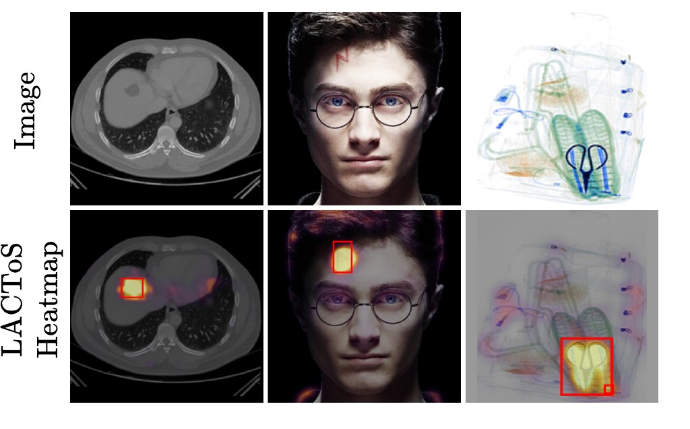
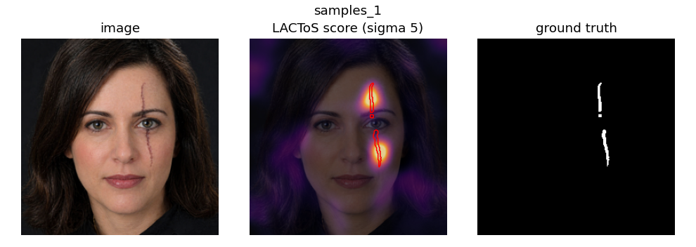
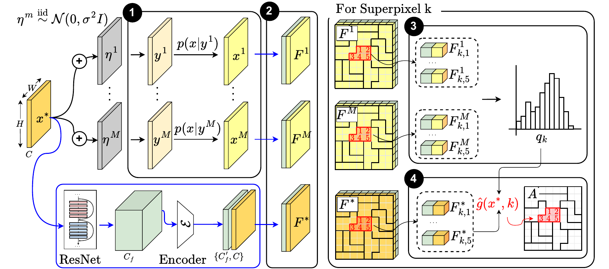
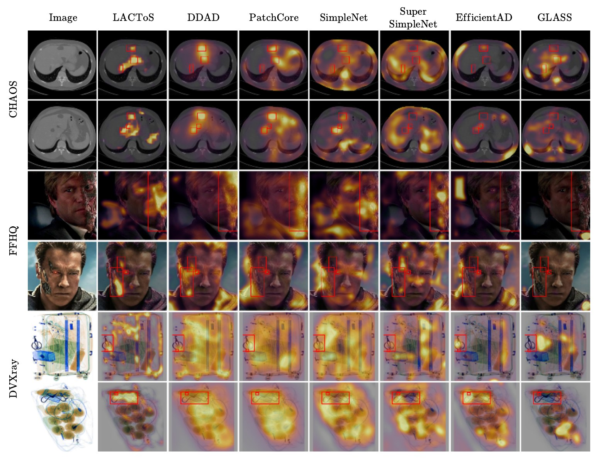

# LACToS: Local Anomaly Detection via Conditional Typicality of Superpixels

Code for the paper *LACToS: Local Anomaly Detection via Conditional Typicality of Superpixels*
(under review at ICLR 2027).

LACToS localises anomalies: spatially confined out-of-distribution regions inside an otherwise
in-distribution image. It needs only an unconditional diffusion model of the in-distribution images
and a posterior sampler; no anomalous training data.



This repository contains

* the implementation of LACToS (`evaluate.py`, `ood/`),
* the diffusion posterior samplers that draw the reconstructions it scores (`sampling/`),
* inference code for the six baselines of the paper (`baselines/`),
* the evaluation code and the scripts that regenerate the paper's main results (`scripts/`),
* trained checkpoints, test data, reconstructions and reference results as a separate download
  (the asset bundle).

## Quick start

### Installation

```bash
git clone https://github.com/voilalab/LACToS.git && cd LACToS

conda create -n lactos python=3.10 && conda activate lactos
pip install torch==2.0.1 torchvision==0.15.2 --index-url https://download.pytorch.org/whl/cu118
pip install -r requirements.txt
```

`environment/lactos.txt` is the exact pip freeze of this environment, the one the paper's numbers
were produced with (it also runs the EfficientAD and DDAD baselines).

### The asset bundle

Everything the code needs besides itself is in one archive:
[`LACToS_assets.tar`](https://drive.google.com/file/d/1o5bz1IcF077sUJUqgsZIuAWurfJMjtsj/view?usp=sharing)
(Google Drive, 7.5 GB).

```bash
pip install gdown && gdown 1o5bz1IcF077sUJUqgsZIuAWurfJMjtsj   # or download from the link above
tar xf LACToS_assets.tar                     # -> LACToS_assets/
ln -s /path/to/LACToS_assets assets          # or: export ASSETS=/path/to/LACToS_assets
bash scripts/check_assets.sh                 # checks the environment and that the bundle is complete
```

| Folder | Contents |
|---|---|
| `checkpoints/diffusion/` | the unconditional diffusion models of CHAOS, DVXray and FFHQ (step 1 of the method) |
| `checkpoints/lactos/` | the per-dataset pixel autoencoders and the fine-tuned ResNet-101 used for DVXray (step 2) |
| `checkpoints/baselines/{ffhq,ct,xray}/` | PatchCore memory banks, SimpleNet / SuperSimpleNet / GLASS / EfficientAD weights, DDAD UNets |
| `data/` | test images, ground-truth masks, CT body masks, the 20-image tuning subsets |
| `recons/` | the reconstructions scored in the paper: CHAOS 5 draws, DVXray 20 draws, FFHQ 20 seeds per test image |
| `reference_results/` | the per-image score maps of LACToS and of the six baselines from our verification run (Table 1 recomputes from them exactly) |

Layout of the bundle: `docs/BUNDLE.md`. What each file is and what it was trained on:
`docs/PROVENANCE.md`.

### Run LACToS on two images

The per-dataset configs in `configs/` hold the paper's settings, so one flag is enough to score a
set. This scores the first two FFHQ test faces (about one minute on a GPU), draws the heatmaps and
reports the pooled metrics of the two images:

```bash
python evaluate.py --config configs/lactos_ffhq_faces.yaml --max_samples 2 --dump_maps results/quickstart --output_dir results/quickstart
python scripts/plot_maps.py results/quickstart --sigma 5
python full_metric_table.py --maps_dir results/quickstart --out results/quickstart/metrics.json --sigma 5
```

Expected output (abridged):

```
  [samples_1]
  44 -> 4096 superpixels
  AE loaded: assets/checkpoints/lactos/ae_faces.pth  (embed_dim=1792, latent_dim=3)
  Scored 4055 superpixels
  Dumped map: results/quickstart/samples_1.npz
  ...
  2 samples scored, 0 failed -> results/quickstart/faces_random.json
results/quickstart/samples_1.png
results/quickstart/samples_10.png
{
 "n_maps": 2,
 "pooled_auroc": 0.9773,
 "pooled_aupr": 0.2022,
 ...
 "aupro": 0.9064,
```

`results/quickstart/samples_1.png` should look like this (image, LACToS score, ground truth):



The metrics are over two images only and are an installation check, not a result. On a GPU other
than ours the last digits can differ (see "Main results").

### Rebuild Table 1 without a GPU

The bundle's `reference_results/` folder holds the score maps of every method, so the whole table
can be recomputed in a few minutes on a CPU:

```bash
python scripts/make_table1.py --maps reference
# ...
# 63/63 cells within tolerance (|delta| <= 0.005, DDAD 0.03); 63/63 agree at 4 decimals.
# PASS
```

## Method



1. **Posterior sampling.** M noisy copies of the test image are denoised with diffusion posterior
   sampling (DPS) under an unconditional diffusion model trained on in-distribution images, which
   gives M reconstructions.
2. **Feature extraction.** The image and every reconstruction pass through a pretrained ResNet-101;
   the multi-scale activations are compressed to three dimensions per pixel by an autoencoder
   trained on the in-distribution data, and concatenated with the intensity values.
3. **Histogram fitting.** The test image is partitioned into superpixels of a chosen average size.
   For each superpixel, the intensity values and the feature values of all reconstruction pixels
   inside it form two histograms.
4. **Typicality.** The score of a superpixel is the average negative log-likelihood of the test
   image's pixels under a histogram minus the histogram's entropy; the intensity term and λ times
   the feature term are added.
5. **Smoothing.** The superpixel scores are smoothed with a spatial Gaussian into the anomaly map.

| Step | Code |
|---|---|
| 1 | `sampling/dps/sample_fast.py` (CHAOS, DVXray), `sampling/generate_recons.py` (FFHQ), run by `scripts/sample_*.sh` |
| 2 | `ood/embeddings.py`, `PixelAutoEncoder` in `evaluate.py` |
| 3 | `ood/superpixels.py`, `ood/scoring.py` |
| 4 | `ood/scoring.py` |
| 2–4 for a set of images | `evaluate.py`, run by `scripts/score_lactos.sh` |
| 5 and the metrics | `scripts/make_table1.py`, `full_metric_table.py` |

## Main results

Pooled pixel-level AUROC / AP / AUPRO on three local-anomaly benchmarks: CHAOS (abdominal CT with
synthetic tumours), FFHQ (faces with prosthetics or atypical features) and DVXray (baggage X-ray,
scissors). This is Table 1 of the paper.

| Dataset | Metric | PatchCore | SimpleNet | SuperSimpleNet | EfficientAD | GLASS | DDAD | **LACToS** |
|---|---|---:|---:|---:|---:|---:|---:|---:|
| CHAOS | AUROC | 0.9297 | 0.7464 | 0.3786 | 0.6664 | 0.8318 | **0.9707** | 0.9620 |
| | AP | 0.0590 | 0.0193 | 0.0051 | 0.0105 | 0.0410 | 0.3159 | **0.4318** |
| | AUPRO | 0.6811 | 0.4191 | 0.0332 | 0.2513 | 0.5530 | 0.8676 | **0.8764** |
| FFHQ | AUROC | 0.8491 | 0.7162 | 0.7647 | 0.6200 | 0.6707 | 0.7469 | **0.8515** |
| | AP | 0.0798 | 0.0537 | 0.0772 | 0.0405 | 0.0345 | 0.0563 | **0.1177** |
| | AUPRO | 0.4094 | 0.3174 | 0.4047 | 0.2365 | 0.2440 | 0.3083 | **0.5320** |
| DVXray | AUROC | **0.9640** | 0.9234 | 0.8688 | 0.9184 | 0.8944 | 0.8567 | 0.9607 |
| | AP | 0.0545 | 0.0254 | 0.0165 | 0.0235 | 0.0155 | 0.0118 | **0.0568** |
| | AUPRO | 0.8141 | 0.6577 | 0.5351 | 0.6592 | 0.6062 | 0.5183 | **0.8179** |

Heatmaps of every method on two test images per benchmark (red: ground truth):



Every number in the table is regenerated by the pipeline below from the reconstructions,
checkpoints and test data of the bundle; `scripts/make_table1.py` prints a cell-by-cell comparison
with `expected/table1.json`. The maps in `reference_results/` reproduce the table exactly. Maps
computed on other hardware differ from ours in float32 round-off, which moves a few values across
histogram-bin edges and shifts the metrics in the third to fourth decimal (DDAD, whose reverse
process is stochastic, by up to 0.03); the comparison therefore applies a tolerance of 0.005
(DDAD 0.03) and `--exact` asks for agreement at four decimals. `docs/REPRODUCIBILITY.md` records
our verification runs and an independent run on another machine.

## Reproducing Table 1

| Stage | Script | What it does | Needs |
|---|---|---|---|
| 0 | `scripts/check_assets.sh` | checks the environment and that the bundle is complete | bundle |
| 1 (optional) | `scripts/sample_{ct,xray,ffhq}.sh` | samples the reconstructions with DPS; the bundle already contains them | diffusion models, test images |
| 2a | `scripts/score_lactos.sh` | LACToS scoring → per-image score maps | reconstructions, autoencoders |
| 2b (optional) | `scripts/run_baselines.sh` | the six baselines → per-image raw maps | baseline checkpoints, three more environments |
| 3 | `scripts/make_table1.py` | smoothing, pooled metrics, the result table and its comparison with the paper | stages 2a and 2b, or the bundle's reference maps |

All scripts take `GPU=<index>`, `OUT=<results dir>` (default `results/`) and
`ASSETS=<bundle dir>`. The default path regenerates the LACToS column and takes the baselines
from the bundle:

```bash
GPU=0 bash scripts/score_lactos.sh                 # ~2-3 GPU-hours; or one benchmark: CT | xray | ffhq
python scripts/make_table1.py                      # your LACToS maps + the reference baseline maps (marked "ref")
```

### Stage 2a: LACToS scoring

`scripts/score_lactos.sh` runs `evaluate.py` on every image set with the configs in `configs/`
and writes one file per test image,
`results/lactos_maps/<benchmark>/<setting>/<set>/samples_<id>.npz`, holding the unsmoothed score
map (`delta_map`), the ground-truth mask and the valid-pixel mask. For FFHQ it runs twice, with
and without the feature term, so that stage 3 can weight the two terms.
`MAX_SAMPLES=2 GPU=0 bash scripts/score_lactos.sh ffhq` is a smoke test on two images per set.
To score reconstructions you sampled yourself (stage 1), point it at them:
`RECON_ROOT=results/recons_mine GPU=0 bash scripts/score_lactos.sh`.

### Stage 2b (optional): baselines

`scripts/run_baselines.sh` runs PatchCore, SimpleNet, SuperSimpleNet, EfficientAD, GLASS and
DDAD with the checkpoints of the bundle and writes
`results/baseline_maps/<benchmark>/<method>/<setting>/<set>__<id>.npz`. Skip it to use the
bundle's reference maps instead. It needs the official implementations of PatchCore, SimpleNet,
GLASS and SuperSimpleNet and three more conda environments (`environment/`); EfficientAD and DDAD
run in the `lactos` environment:

```bash
bash scripts/fetch_third_party.sh          # clones the four upstream repositories at the commits we used

conda create -n patchcore python=3.10 && conda activate patchcore
pip install torch==2.4.1 torchvision==0.19.1 --index-url https://download.pytorch.org/whl/cu118
pip install -r environment/patchcore.txt

conda create -n simplenet python=3.10 && conda activate simplenet       # SimpleNet and GLASS
pip install torch==2.4.1 torchvision==0.19.1 --index-url https://download.pytorch.org/whl/cu118
pip install -r environment/simplenet.txt

conda create -n ssn_env python=3.10 && conda activate ssn_env           # SuperSimpleNet
pip install torch==2.1.0 torchvision==0.16.0 --index-url https://download.pytorch.org/whl/cu118
pip install -r environment/ssn_env.txt

conda activate lactos
GPU=0 bash scripts/run_baselines.sh        # ~1.5 GPU-hours; or one benchmark: ffhq | ct | xray
```

The script finds the three environments under conda's `envs/` directory by these names; set
`PY_PATCHCORE=... PY_SIMPLENET=... PY_SSN=...` or `CONDA_ENVS=/path/to/conda/envs` otherwise.

### Stage 3: evaluation

`scripts/make_table1.py` weights the intensity and feature terms, smooths every map, pools the
pixels of each benchmark and computes the metrics. It writes `results/table1.{json,md,tex}` and
prints the comparison with the paper's numbers. For every method it uses the maps under
`results/` and falls back to `reference_results/` for methods you did not run (`--maps mine`
disables the fallback, `--maps reference` uses only the reference maps, `--only lactos` /
`--only baselines` restrict the table).

### Stage 1 (optional): sampling the reconstructions

The reconstructions LACToS scores are in the bundle (`recons/`). These commands regenerate them
with DPS from `checkpoints/diffusion/` and `data/`:

```bash
GPUS="0 1 2 3" bash scripts/sample_ct.sh       # CHAOS
GPUS="0 1 2 3" bash scripts/sample_xray.sh     # DVXray
GPUS="0 1 2 3" bash scripts/sample_ffhq.sh     # FFHQ
```

They write to `results/recons_mine/` in the layout of `recons/`; score them with
`RECON_ROOT=results/recons_mine GPU=0 bash scripts/score_lactos.sh` (stage 2a). FFHQ reproduces the
bundled reconstructions up to PNG rounding; CHAOS and DVXray give new posterior draws on every run,
which changes their LACToS cells in the second to third decimal. Sampler settings, output layout and
smoke tests: `sampling/README.md`.

## Applying LACToS to other images

`evaluate.py` scores one set of 256×256 images from a config. Copy `configs/template.yaml`, edit
its `data:` block, run:

```bash
cp configs/template.yaml configs/mydata.yaml   # edit the paths in data:
python evaluate.py --config configs/mydata.yaml
python scripts/plot_maps.py results/mydata/maps --sigma 5
python full_metric_table.py --maps_dir results/mydata/maps --out results/mydata/metrics.json --sigma 5
```

The config needs

* the posterior samples and the test image of every sample,
  `<results_dir>/samples_<id>/<test_origin>_0_4/inpainting/recon/*.png` and `.../label/0_00000.png`
  (`sampling/` writes this layout; a new dataset needs an unconditional diffusion model of its
  in-distribution images in guided-diffusion format, see `sampling/README.md`),
* the test images `<image_dir>/<id>.png` and binary ground-truth masks
  `<gt_mask.path>` with `{sample}` = `<id>` (all-zero for anomaly-free images),
* for the feature term, an autoencoder checkpoint (`scoring.autoencoder_path`, architecture
  `PixelAutoEncoder` in `evaluate.py`, trained on in-distribution images); the template scores
  intensities only (`use_pca: false`).

The template uses the paper's FFHQ setting (20-pixel superpixels, 16 intensity bins, histogram
σ 1). Every config value can be overridden on the command line (`python evaluate.py --help`), and
`full_metric_table.py --sigma` sets the spatial smoothing of step 5.

## Evaluation protocol and hyperparameters

* **Metrics** (`full_metric_table.py`, used identically for every method): all valid pixels
  of all test images of a benchmark are pooled; AUROC and AP over that pool; AUPRO is the
  area under the per-region-overlap curve up to FPR 0.3, normalised by 0.3. Anomalous and
  anomaly-free images are pooled together (CHAOS 100 + 100 slices, FFHQ 50 + 50 faces, DVXray
  72 + 72 bags); CHAOS pixels outside the body mask are excluded. Every map is smoothed with a
  Gaussian before pooling (LACToS: σ in the table below; baselines: each method's published
  composition, i.e. its internal σ = 4 blur followed by σ = 5).
* **LACToS** (paper Table 5; the values are the defaults of `configs/lactos_*.yaml`, and
  `docs/HYPERPARAMETERS.md` lists every flag):

  | | superpixel size | draws M | histogram σ | bins (intensity × feature) | λ | spatial σ |
  |---|---:|---:|---:|---|---:|---:|
  | CHAOS | 100 | 5 | 0.5 | 16 × 64 | 1 | 2 |
  | FFHQ | 20 | 20 | 1 | 16 × 32 | 0.25 | 5 |
  | DVXray | 10 | 20 | 0 | 16 × 16 | 0 | 5 |

  λ weights the feature term against the intensity term; λ = 0 (DVXray) is the intensity-only score.
* **Baselines** (paper Table 6): PatchCore k = 1; EfficientAD α = 0 / 0.7 / 0.2
  (CHAOS / FFHQ / DVXray); DDAD T = 250, skip 25, η = 1 with (w, v) = (2, 1) / (2, 4) / (4, 4);
  SimpleNet, SuperSimpleNet and GLASS at their defaults.

## Repository layout

```
evaluate.py           LACToS scorer (reconstructions -> features -> superpixels -> typicality -> score map)
ood/                  data loading, ResNet pixel embeddings, superpixels, typicality scoring, DPS sampler classes
embedder/             evaluate_ddad_fe.py: scorer variant that loads the fine-tuned DVXray backbone
sampling/             DPS samplers: sampling/dps (CHAOS, DVXray: guided-diffusion + sample_fast.py), generate_recons.py (FFHQ), wire_recons.py
DDAD_DPS/             reverse process used by the FFHQ sampler
baselines/            table1_common.py, infer_feature.py, infer_ddad.py, compose.py, ddad_lib/ (DDAD modules)
full_metric_table.py  pooled and per-image metrics (AUROC, AP, AUPRO, ...)
scripts/              check_assets.sh  sample_*.sh  score_lactos.sh  run_baselines.sh  make_table1.py  plot_maps.py  fetch_third_party.sh
configs/              evaluate.py configs per dataset with the paper's settings, template.yaml for new data; configs/recon/ = FFHQ sampler configs
expected/table1.json  the paper's numbers
docs/                 HYPERPARAMETERS.md  PROVENANCE.md  BUNDLE.md  REPRODUCIBILITY.md  figures/
environment/          pip freeze of the four environments (lactos.txt, patchcore.txt, simplenet.txt, ssn_env.txt)
tools/                check_bundle.py (stage 0), seeded_run.py (seeds every stage-2a run)
```

## Citation

```bibtex
@misc{lactos,
  title  = {{LACToS}: Local Anomaly Detection via Conditional Typicality of Superpixels},
  author = {Anonymous},
  note   = {Under review at ICLR 2027},
  year   = {2026}
}
```

## Acknowledgements

DDAD (Mousakhan et al.), DPS (Chung et al.), guided-diffusion (Dhariwal & Nichol), PatchCore,
SimpleNet, SuperSimpleNet, EfficientAD and GLASS are used through their official implementations;
see `third_party/README.md` for the exact commits.
